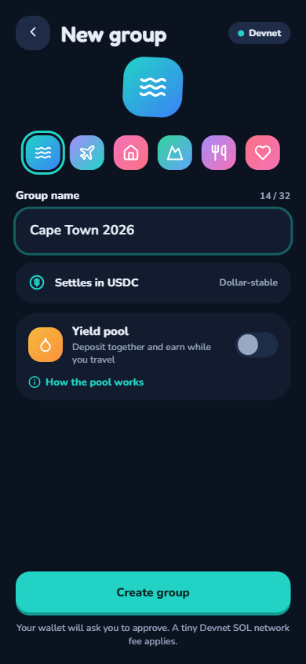
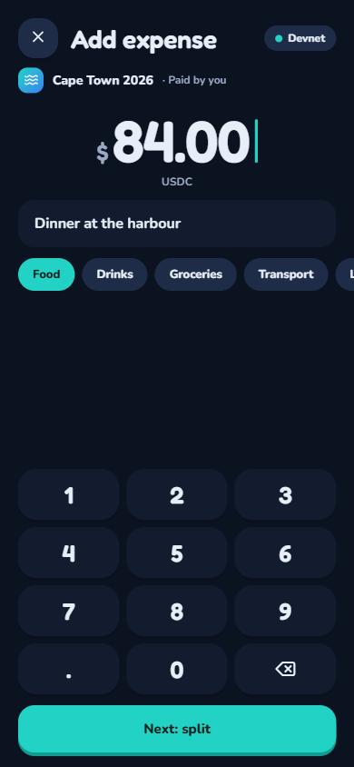
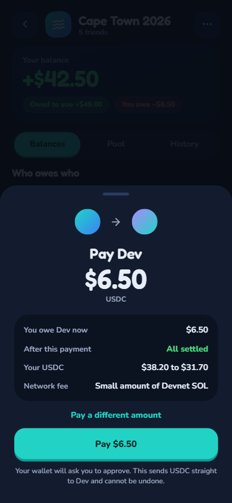
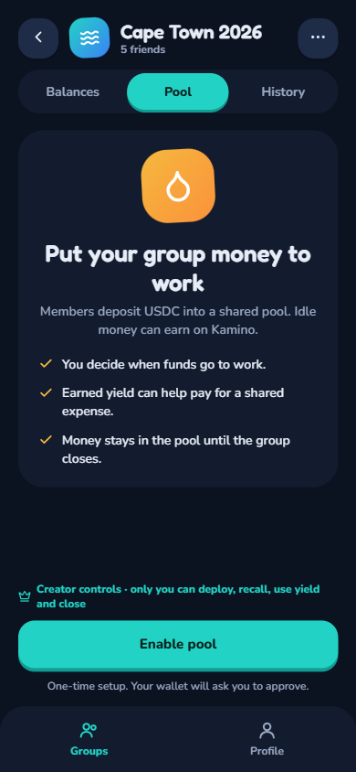
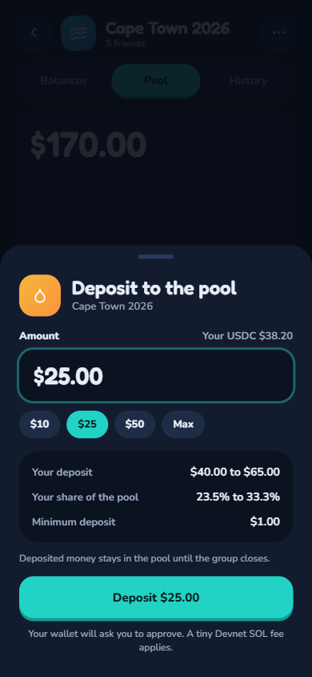
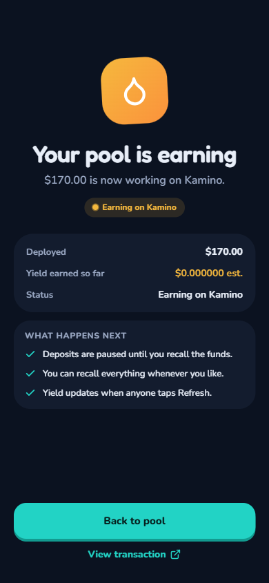
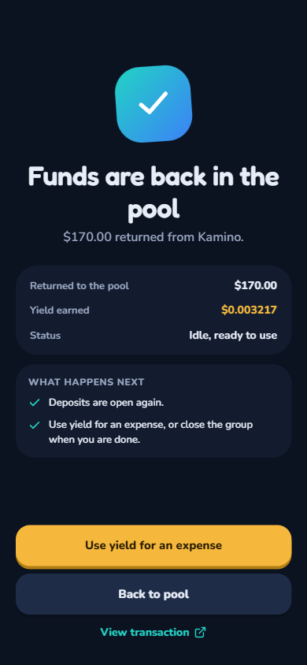
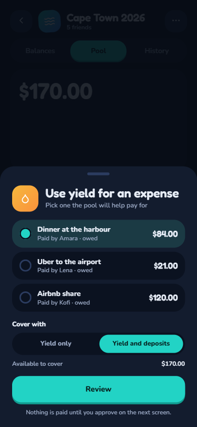

# Float — Frontend

> **Group expenses, without the awkward money chase.**
>
> Float is a mobile-first social finance experience for groups that share costs. Track expenses together, settle in stablecoins on Solana, and optionally let pooled funds earn yield while the group gets on with life.

<p align="center">
  <strong>Split the cost. Settle the balance. Let the group's money work in the meantime.</strong>
</p>

---
🚨 Live Demo — Still Under Development
<table>
  <tr>
    <td align="center" width="100%">
      <br>
      <h2>👉 <a href="https://f5fb6200.floatfinance.pages.dev/">TRY THE LIVE DEMO</a> 👈</h2>
      <p><strong>https://f5fb6200.floatfinance.pages.dev/</strong></p>
      <br>
      <p>⚠️ <strong>The app is still under active development.</strong><br>
      Only the colored steps below are currently implemented.<br>
      Greyed-out steps are planned and will light up as they ship.</p>
      <br>
    </td>
  </tr>
</table>

---

## The problem is familiar

A group trip ends. The spreadsheet says who owes what. Someone has paid for the apartment, another covered dinner, and a third booked the rides. The app has done the arithmetic, but the group is still waiting on transfers, reminders, and "I'll send it tonight."

Float is built around a simple idea: **expense tracking should lead to actual settlement, and shared money should not have to sit idle while the group is together.**

Traditional split apps organize debt. Float brings the group ledger and the money movement closer together, with an optional shared pool that can be deployed to Kamino and later used to subsidize group expenses.

## Meet Float

Float combines three connected experiences:

- **A shared expense ledger:** create groups, invite members, log expenses, and see who owes whom.
- **On-chain settlement:** connect a Solana wallet and settle group balances with stablecoins.
- **An optional yield pool:** members can contribute funds, the group can deploy them to Kamino, and available yield can help pay for a shared expense.

The pool is optional by design. A group can use Float as a straightforward expense splitter without enabling yield.

## A real-world use case: one weekend, one shared balance

Imagine Amara planning a weekend in Cape Town with four friends from three countries.

1. She creates **Cape Town 2026** and enables the Yield Pool.
2. Everyone joins and contributes an amount that works for them.
3. The group deploys its pooled funds to Kamino.
4. During the trip, members log rides, accommodation, and meals using equal or custom splits.
5. Balances update on-chain, while the app presents people through profiles rather than making the experience revolve around wallet strings.
6. Before leaving, the group recalls its funds and chooses **Use Yield for Expense** for the final dinner.
7. The pool covers what it can. Any remainder stays visible as ordinary group debt.
8. The creator closes the group; each member withdraws their proportional share of the remaining pool value.

The result: fewer payment chases, a shared record everyone can inspect, and a chance for idle group capital to contribute to the cost of the experience.

---

Implementation Status
Progress is shown as cards. Color = live today. Grey = not yet implemented.
1. Bill Splitting Flow
<table>
  <tr>
    <td align="center" width="16%">
      <div style="border: 2px solid #22c55e; border-radius: 12px; padding: 12px; background: #f0fdf4;">
        <strong>✅ Wallet Connect</strong><br>
        <small>Onboarding</small>
      </div>
    </td>
    <td align="center" width="16%">
      <div style="border: 2px solid #22c55e; border-radius: 12px; padding: 12px; background: #f0fdf4;">
        <strong>✅ Create Group</strong><br>
        <small>Name + members</small>
      </div>
    </td>
    <td align="center" width="16%">
      <div style="border: 2px solid #d1d5db; border-radius: 12px; padding: 12px; background: #f9fafb; color: #9ca3af;">
        <strong>⬜ Join Group</strong><br>
        <small>Invite link</small>
      </div>
    </td>
    <td align="center" width="16%">
      <div style="border: 2px solid #22c55e; border-radius: 12px; padding: 12px; background: #f0fdf4;">
        <strong>✅ Log Expense</strong><br>
        <small>Equal + custom</small>
      </div>
    </td>
    <td align="center" width="16%">
      <div style="border: 2px solid #d1d5db; border-radius: 12px; padding: 12px; background: #f9fafb; color: #9ca3af;">
        <strong>⬜ View Balances</strong><br>
        <small>Who owes whom</small>
      </div>
    </td>
    <td align="center" width="16%">
      <div style="border: 2px solid #d1d5db; border-radius: 12px; padding: 12px; background: #f9fafb; color: #9ca3af;">
        <strong>⬜ Settle</strong><br>
        <small>On-chain USDC</small>
      </div>
    </td>
  </tr>
</table>
2. Yield Pool Flow
<table>
  <tr>
    <td align="center" width="14%">
      <div style="border: 2px solid #d1d5db; border-radius: 12px; padding: 12px; background: #f9fafb; color: #9ca3af;">
        <strong>⬜ Enable Pool</strong><br>
        <small>Optional</small>
      </div>
    </td>
    <td align="center" width="14%">
      <div style="border: 2px solid #d1d5db; border-radius: 12px; padding: 12px; background: #f9fafb; color: #9ca3af;">
        <strong>⬜ Deposit</strong><br>
        <small>USDC → shares</small>
      </div>
    </td>
    <td align="center" width="14%">
      <div style="border: 2px solid #d1d5db; border-radius: 12px; padding: 12px; background: #f9fafb; color: #9ca3af;">
        <strong>⬜ Deploy</strong><br>
        <small>to Kamino</small>
      </div>
    </td>
    <td align="center" width="14%">
      <div style="border: 2px solid #d1d5db; border-radius: 12px; padding: 12px; background: #f9fafb; color: #9ca3af;">
        <strong>⬜ Recall / Harvest</strong><br>
        <small>Bring funds back</small>
      </div>
    </td>
    <td align="center" width="14%">
      <div style="border: 2px solid #d1d5db; border-radius: 12px; padding: 12px; background: #f9fafb; color: #9ca3af;">
        <strong>⬜ Use Yield</strong><br>
        <small>Pay expense</small>
      </div>
    </td>
    <td align="center" width="14%">
      <div style="border: 2px solid #d1d5db; border-radius: 12px; padding: 12px; background: #f9fafb; color: #9ca3af;">
        <strong>⬜ Close + Withdraw</strong><br>
        <small>Proportional</small>
      </div>
    </td>
    <td align="center" width="14%">
      <div style="border: 2px solid #d1d5db; border-radius: 12px; padding: 12px; background: #f9fafb; color: #9ca3af;">
        <strong>⬜ Profiles</strong><br>
        <small>Name + avatar</small>
      </div>
    </td>
  </tr>
</table>
> **How this works:** As soon as a phase ships, we update its card from grey → green. This README becomes the single place to see real progress at a glance.

---

## Product capabilities

| Experience | What members can do |
|---|---|
| Groups | Create and join shared groups |
| Expense entry | Record an expense and choose equal or custom splits |
| Balances | See net positions and who owes whom |
| Settlement | Settle with a stablecoin through Solana |
| Profiles | See display names and avatars alongside wallet-linked activity |
| Pool | Enable an optional pool and deposit USDC |
| Yield | View pool value / yield information and deployment status |
| Pool-funded expense | Apply recalled pool value to an already-logged expense |
| History | Review expenses, including whether an expense was paid from the pool |
| Group closeout | Close the group and withdraw proportional remaining pool value |

**Feature status:** this table describes the product scope in the supplied design. Check the running app and current integration before marking individual features as implemented or demo-ready.

## Designed for two modes

<details>
<summary><strong>1. Pure expense splitting</strong></summary>

Connect wallet → Create group → Join group → Log expense → Review balances → Settle.

No pool is required. This path is intended to remain fast and simple for groups that only need shared expense tracking and settlement.
</details>

<details>
<summary><strong>2. Yield-enabled group</strong></summary>

Create group → Enable pool → Members deposit → Creator deploys to Kamino → Harvest / view yield → Creator recalls funds → Apply pool value to an expense → Close group → Members withdraw.

The pool-funded expense path requires funds to be recalled first. If the pool cannot cover the full expense, the remainder stays as normal group debt.
</details>

## See Float in action

The screenshots below are organized around the moments that make Float different: getting a group started, recording and settling shared expenses, and putting pooled funds to work. Replace each image path with a real screenshot from the app. Keeping the images in `docs/images/` makes the README portable and keeps the repository tidy.

### 1. Bill splitting: from group creation to settlement

A simple, familiar expense flow is the foundation. The optional yield experience builds on top of it rather than getting in the way.

#### Create a group

Start with a shared space for the people, expenses, and balances that belong together.



<sub>Milestone 1 · Create group</sub>

#### Add an expense

Record who paid, how much it cost, and how the expense should be split. Float supports equal and custom participant shares.



<sub>Milestone 2 · Add expense</sub>

#### Settle balances

Turn the group's ledger into an on-chain stablecoin settlement, with transaction status visible to the user.



<sub>Milestone 3 · Settle</sub>

### 2. Yield pool: make shared funds work harder

For groups that opt in, Float adds a shared pool to the expense experience. Members contribute, the group deploys available funds to Kamino, and recalled value can help cover a shared expense.

#### Create the pool

Enable the pool for a group and make the optional yield path available.



<sub>Milestone 1 · Create pool</sub>

#### Deposit into the pool

Members contribute USDC and receive pool shares representing their proportional claim.



<sub>Milestone 2 · Deposit</sub>

#### Deploy the pool funds to kamino

The group creator can then deploy the pooled funds to kamino for yeild generation.



<sub>Milestone 2 · Deposit</sub>

#### Withdraw from the pool

After the group is closed, members can withdraw their proportional share of the remaining pool value.



<sub>Milestone 3 · Withdraw</sub>

#### Pay for an expense with yield

Once funds have been recalled, the group can apply available pool value to an existing expense. For the demo, this is the memorable moment: **"Yield paid for coffee."** If the pool does not cover the full expense, the remainder stays as ordinary group debt.



<sub>Milestone 4 · Yield paid for coffee</sub>

> **Screenshot note:** These are image slots, not screenshots of the current build. Add genuine captures from the running app at the paths shown above. Do not use mockups that imply a flow is implemented if it is still planned.

### Adding or replacing screenshots

Save the screenshots in `docs/images/` using the filenames referenced above:

```text
docs/
  images/
    bill-splitting-01-create-group.png
    bill-splitting-02-add-expense.png
    bill-splitting-03-settle.png
    yield-pool-01-create-pool.png
    yield-pool-02-deposit.png
    yield-pool-03-withdraw.png
    yield-pool-04-yield-paid-for-coffee.png
```

For a clean GitHub presentation:

- Capture the actual app UI at a consistent viewport size.
- Prefer crisp screenshots around 1200 px wide; keep text legible when scaled down.
- Use the same device frame or no device frame throughout. Avoid mixing styles.
- Crop browser chrome and unrelated desktop content.
- Use real transaction results for settlement, deposit, withdrawal, and yield-funded expense states.
- Blur wallet addresses or personal information that should not be public.
- Keep captions focused on what the screenshot proves, not just which page it shows.

## Product experience and information architecture

The planned navigation keeps the app focused:

```text
Groups  |  Profile

Inside a group:
  Balances  |  Pool  |  History

Key flows:
  Onboarding
  Create / Join Group
  Group Balances
  Log Expense
  Settle Confirmation
  Pool Deposit / Deploy / Recall
  Use Yield for Expense
  Close Group / Withdraw
  Profile / Edit Profile
```

The interface is designed mobile-first. The group is the center of the experience; the pool is a clear, optional layer rather than a prerequisite for splitting an expense.

## Technology

| Layer | Technology |
|---|---|
| Web app | SvelteKit |
| Language | TypeScript (verify current repo configuration) |
| Wallet | Phantom + Solana Wallet Adapter |
| Blockchain | Solana |
| Program client | Anchor-generated IDL / client integration |
| Settlement asset | USDC (primary design asset) |
| Yield integration | Kamino, invoked by the on-chain program |
| Profiles and enrichment | Supabase |
| Hackathon network | Solana Devnet |

### What belongs on-chain vs off-chain?

Float deliberately separates financial truth from social context.

**On-chain source of truth**
- Group configuration and lifecycle
- Member expense balances
- Pool shares and tracked pool value
- Expense records
- Token movement and settlement
- Yield-related state transitions

**Off-chain enrichment**
- Display names, avatars, and profile details
- Expense categories, notes, and receipt media

This boundary matters: profile data can improve the experience, but it must not become the authority for balances, ownership, or settlement.

## How the frontend connects to the program

The client coordinates wallet interaction and presents program state. It should not independently calculate or persist authoritative financial balances.

```text
┌───────────────────────────────┐
│          SvelteKit UI         │
│ Groups · Balances · Pool      │
│ Expense form · History        │
└───────────────┬───────────────┘
                │
        Wallet connection
                │
                ▼
┌───────────────────────────────┐
│    Solana wallet / provider   │
│       Phantom + adapter       │
└───────────────┬───────────────┘
                │ signed transactions
                ▼
┌───────────────────────────────┐
│       Float Anchor program    │
│ Group · MemberBalance         │
│ Pool · Expense                │
└───────────────┬───────────────┘
                │
       ┌────────┴─────────┐
       ▼                  ▼
  SPL token flow      Kamino CPI
                       (program-side)

┌───────────────────────────────┐
│            Supabase           │
│ Profiles · Avatars · Metadata │
└───────────────────────────────┘
```

Typical client responsibilities:

1. Connect a wallet and identify the active cluster.
2. Derive or fetch the relevant program accounts.
3. Present on-chain state and off-chain profile metadata together.
4. Build instructions using the current program IDL.
5. Request wallet signatures and submit transactions.
6. Refresh state from chain after confirmation.
7. Present transaction failures and stale / unavailable data clearly.

The client should never treat a successful button click as proof of settlement. Show confirmed transaction state and handle rejected, failed, and pending transactions distinctly.

## Getting started

This repository uses SvelteKit according to the project design. The exact package manager, scripts, and environment variable names must be taken from the current repository files.

```bash
# Install dependencies with the package manager used by this repo
npm install

# Start the local development server
npm run dev
```

If the repository uses pnpm or another package manager, follow its lockfile and package scripts instead.

### Before connecting to Devnet

- [ ] Confirm the program ID matches the deployed program and generated IDL.
- [ ] Confirm the wallet and RPC connection are both on Devnet.
- [ ] Confirm the configured USDC mint is the intended Devnet mint.
- [ ] Confirm the frontend account layouts and instruction arguments match the current IDL.
- [ ] Confirm Kamino accounts are configured for the same cluster.
- [ ] Configure Supabase using the project's actual environment variable names.
- [ ] Keep service-role keys and other secrets out of browser-exposed variables.
- [ ] Test with a dedicated development wallet and non-production funds.

Do not paste private keys, seed phrases, or service-role secrets into source control.

## Current MVP boundaries and technical debt

A good demo should be clear about what is intentionally simple today and what needs to mature before real users depend on it.

| Area | MVP boundary / known work | Product impact |
|---|---|---|
| Platform | Mobile-first web app; native mobile apps are out of scope for the hackathon | Native iOS / Android experience remains future work |
| Profiles | Supabase stores social profile data and enrichment | Identity and profile availability depend on the off-chain service |
| Expense metadata | Categories, notes, and receipts are off-chain enrichment | The on-chain expense record remains the financial reference |
| Yield liquidity | Pool funds must be recalled before they can fund an expense | The app must communicate the recall step and its latency clearly |
| Pool withdrawals | Withdrawals happen after group closure in the MVP design | Members cannot freely exit a live pool |
| Yield venue | Kamino is the only designed yield venue | No multi-protocol routing or venue comparison yet |
| Analytics | Complex yield charts and advanced analytics are out of scope | Start with clear value, status, and history rather than overstated projections |
| Network | Hackathon flow targets Devnet | Mainnet readiness is a separate engineering milestone |
| Reliability | End-to-end transaction and external protocol failures need clear UX | Users need pending, failed, retry, and recovery states |

### UX and integration work to prioritize

- Make wallet, network, and transaction status visible at the moment they matter.
- Explain the difference between pool principal, total pool value, and accrued yield.
- Make it obvious when funds are deployed and when recall is required.
- Show the amount an expense is eligible to receive from the pool before confirmation.
- Explain partial coverage: the pool pays what it can; the remaining amount stays as member debt.
- Prevent double-submission and stale-state actions around transactions.
- Provide useful empty, loading, error, and disconnected-wallet states.
- Keep the no-pool expense path uncluttered.

## Roadmap

### Next: make the core experience dependable

- Complete and verify the end-to-end Devnet flow for both pure splitting and yield-enabled groups.
- Add transaction lifecycle UX: pending, confirmed, failed, and retry-safe states.
- Improve onboarding so users understand wallets, stablecoins, group balances, and the optional pool.
- Add clear expense history and a visible "paid from pool" indicator.
- Improve profile editing, avatar handling, and metadata loading resilience.
- Test responsive layouts and accessibility across common mobile screen sizes.

### Then: make group money more flexible

- Explore a pool liquidity buffer so expenses do not always require a full recall.
- Design safe partial withdrawals while a group is active.
- Add richer yield history and analytics with clear distinction between realized and estimated values.
- Evaluate additional yield venues only after the protocol abstraction and risk model are ready.
- Consider native mobile / PWA improvements.
- Add notifications and collaboration features that reduce the need for manual follow-ups.

### Before real-money production use

- Complete program and frontend security reviews.
- Add monitoring and support workflows for failed transactions and external protocol issues.
- Define clear risk disclosures and user consent around yield deployment.
- Validate mainnet configuration, token mint selection, and protocol integrations.
- Establish incident response and upgrade / recovery procedures.

## Design principles

- **Money state comes from the chain.** The UI can cache and format it, but cannot become the source of truth.
- **Yield is optional.** The basic split-and-settle flow must remain useful on its own.
- **Make the complex legible.** Pool value, yield, deployment, recall, and withdrawal should be understandable without DeFi expertise.
- **Show the whole transaction lifecycle.** Pending is not confirmed; a failed transaction must not look successful.
- **Build for groups, not wallet power users alone.** Profiles and clear language make on-chain coordination feel social and approachable.

## Project status

The supplied product documents define the intended user journey, information architecture, stack, and MVP boundaries. They describe a Devnet target and an end-to-end demonstration goal, but do not provide verified implementation status, live URLs, or deployment details.

Before submission, add:
- A short demo video or deployed app link.
- Current screenshots of the Groups, Balances, and Pool experiences.
- Verified program ID and Devnet explorer links.
- Exact install / test / build scripts from `package.json`.
- A concise list of what works in the current build versus what is still planned.

## Related project

The on-chain repository contains the Anchor program that owns Float's group accounting, stablecoin settlement, pool shares, and Kamino integration. See that repository for account design, PDA seeds, instruction semantics, security priorities, and program-level roadmap.

---

*Float is a hackathon-stage project. Yield is variable and not guaranteed. Smart-contract, token, liquidity, wallet, and external-protocol risks apply. This software is experimental and is not financial advice.*
